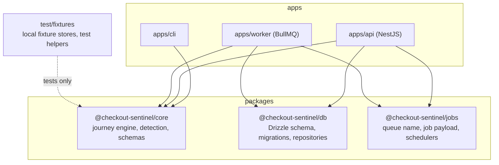
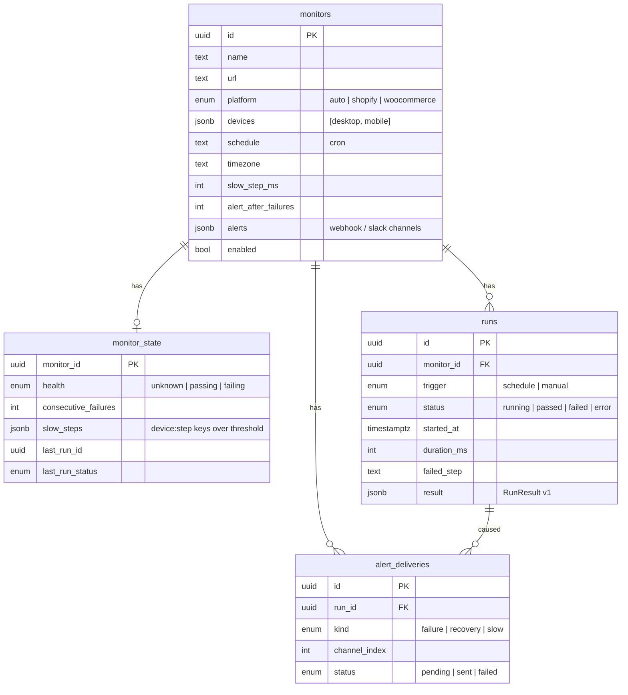
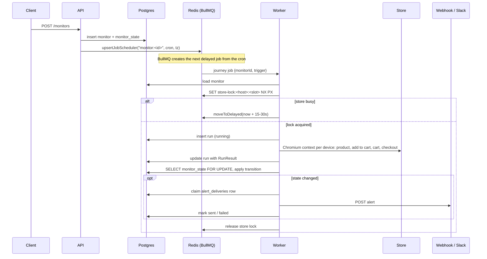
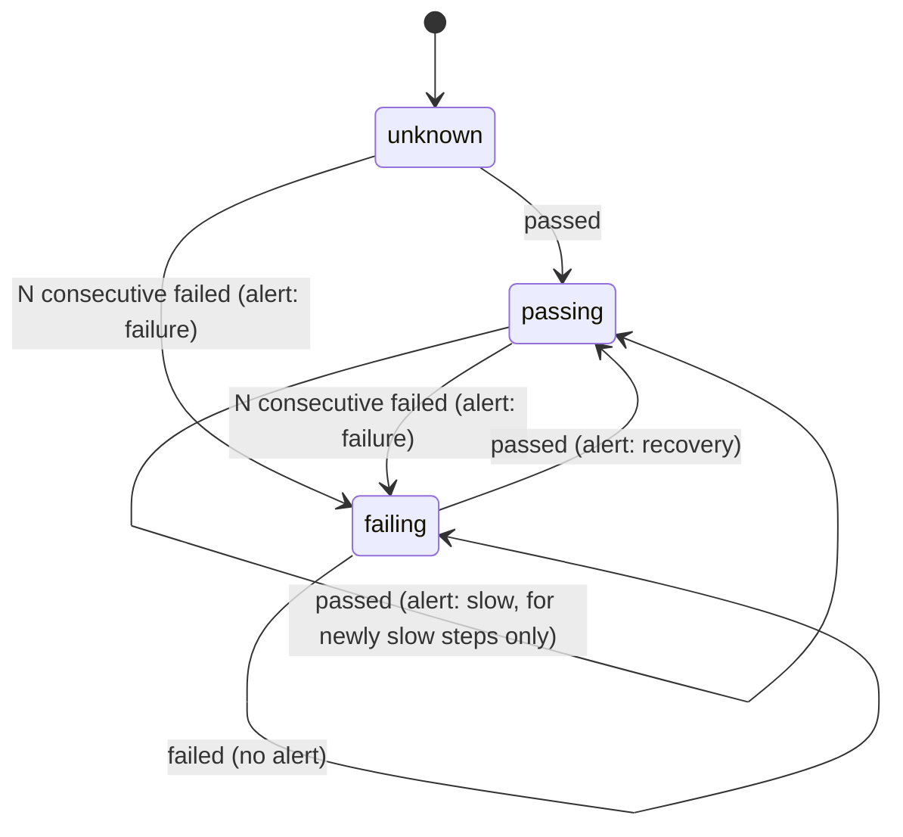
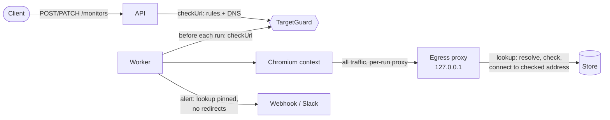

# Architecture

This document describes how checkout-sentinel v0.1 is put together, why, and where it is
expected to change as it grows into a hosted service.

## Components

| Package / app   | Responsibility                                                                                                                                                                                                                                                                                                                 | Depends on                   |
| --------------- | ------------------------------------------------------------------------------------------------------------------------------------------------------------------------------------------------------------------------------------------------------------------------------------------------------------------------------ | ---------------------------- |
| `packages/core` | Runs journeys with Playwright. Owns the result schema (zod, `RESULT_SCHEMA_VERSION = 1`), the monitor schema shared by the CLI config and the API, platform detection, selectors, cart reading, the order guard and the SSRF guard (address classifier, `TargetGuard`, egress proxy). Has no knowledge of databases or queues. | playwright, zod, cron-parser |
| `packages/db`   | Postgres tables, SQL migrations generated by drizzle-kit, and repositories (`MonitorRepository`, `RunRepository`, `StateRepository`, `AlertDeliveryRepository`).                                                                                                                                                               | drizzle-orm, pg              |
| `packages/jobs` | The queue contract between API and worker: queue name, job payload schema, scheduler ids, default job options and `JourneyScheduler`.                                                                                                                                                                                          | bullmq, ioredis              |
| `apps/cli`      | Human and JSON output, YAML config, exit codes. Runs journeys in process.                                                                                                                                                                                                                                                      | core                         |
| `apps/api`      | REST API, validation (including the input-time SSRF check), OpenAPI, auth, schedule reconciliation, migrations on boot, API metrics.                                                                                                                                                                                           | core, db, jobs, NestJS       |
| `apps/worker`   | Executes jobs: store lock, browser pool, journey (with the use-time SSRF check), persistence, alert state machine, guarded delivery, worker metrics.                                                                                                                                                                           | core, db, jobs               |
| `test/fixtures` | Shopify-like and WooCommerce-like Express stores with broken variants, a webhook receiver and Postgres/Redis probes for e2e tests.                                                                                                                                                                                             | express, pg, ioredis         |

The boundary that matters most is `core`. It takes options and returns a `RunResult`; it can be
embedded in a CLI, a worker, a serverless function or a future Shopify app without change.

## Data model

Notes:

- `runs.result` stores the whole `RunResult` as JSONB. The columns next to it (`status`,
  `failed_step`, `duration_ms`, `detected_platform`) exist so list views never parse JSON.
  `(monitor_id, started_at desc)` is indexed and history uses keyset pagination on `started_at`.
- `monitor_state` is one row per monitor. It is both the memory of the alerting state machine and
  the "latest status" read model, so `GET /monitors` is a single join.
- `alert_deliveries` has a unique index on `(run_id, kind, channel_index)`. The worker inserts the
  row before sending; if the insert conflicts, the alert was already handled.
- All foreign keys cascade on monitor delete.

## Job flow

Schedules live in two places: Postgres is the source of truth, and BullMQ holds one job scheduler
per enabled monitor. The API writes both on create, update and delete, and on every boot it
re-upserts all schedulers and removes orphans. If Redis is flushed or a write between the two
stores fails, a restart of the API repairs it.

## Alert state machine

`N` is the monitor's `alertAfterFailures`. Runs with status `error` leave the state untouched:
they describe our infrastructure, not the store. The transition function is pure
(`apps/worker/src/alerting/state-machine.ts`) and covered by unit tests; it is applied inside a
transaction holding a row lock on `monitor_state`, so two runs finishing together cannot both
alert.

## Outbound requests and SSRF

Every URL the system fetches for a user (product pages, webhooks, Slack) goes through one
policy, `TargetGuard` in `packages/core/src/ssrf.ts`. It is checked twice: when the API accepts
the URL, and when the worker uses it, because DNS can change in between.

- **Rules.** http or https only, no credentials in the URL, ports 80 and 443 unless allowed,
  Slack channels on `https://hooks.slack.com/` only, and no host that is, or resolves to, a
  loopback, private, CGNAT, link-local, unique-local, IPv4-mapped, multicast, unspecified or
  reserved address. The classifier parses IPv4 the way the WHATWG URL parser does, so decimal,
  octal and hex forms cannot slip past it.
- **Input time.** The API runs the full check, DNS included, after schema validation and
  answers 400 with one issue per refused URL. A name that does not resolve is accepted; it is
  checked again before use.
- **Use time, journey.** `runJourneys` checks the product URL first and returns status `error`
  when it is refused. Then, unless private targets are allowed, it starts an `EgressProxy` on
  127.0.0.1 for the run and gives each browser context `proxy: { server }`. Playwright's route
  handlers are not called for redirect hops, so routing cannot stop a redirect to an internal
  host; the proxy sees every connection, redirect hops and cart API reads included. HTTPS is
  tunnelled with `CONNECT`, so the browser's own TLS reaches the store. Refused connections are
  recorded per step and listed in the step's `details.blockedRequests`. A failed step's message
  names a refused or failed connection only when it can be the cause: a main-frame navigation
  or redirect hop during that step, or the store's own host and port. A refused image, script
  or frame does not fail a step and does not change its message.
- **Use time, alerts.** Deliveries use `node:http`/`node:https` with the guard's `lookup`, a
  fresh connection each time and no redirect following.
- **Pinning.** The proxy and alert deliveries pass `TargetGuard.lookup` to the socket. It
  resolves the name, refuses the answer if any address is not public, and hands the socket
  only the addresses it checked. A short-TTL name cannot pass the check with one answer and
  connect with another.
- **Opt-in for development.** `ALLOW_PRIVATE_TARGETS=true` skips the address, port and Slack
  checks, and no proxy is started. The fixture tests use it. `ALLOWED_TARGET_HOSTS` and
  `ALLOWED_TARGET_PORTS` are narrower exceptions for production. The CLI runs without a guard
  unless `--block-private-targets` is passed.

## Failure handling

| Failure                                      | Behavior                                                                                                                                                                                      |
| -------------------------------------------- | --------------------------------------------------------------------------------------------------------------------------------------------------------------------------------------------- |
| A journey step fails                         | A normal result: run stored as `failed`, state machine decides about alerts. The job succeeds.                                                                                                |
| Chromium fails to launch or crashes mid-run  | `runJourneys` returns status `error` with the message; no alert. The browser pool drops a disconnected browser and launches a new one on the next job.                                        |
| Exception in the worker (database down, bug) | The run is marked `error`, the job throws, BullMQ retries once after 30 seconds (exponential backoff).                                                                                        |
| Worker killed mid-job                        | BullMQ's lock expires and the job is picked up again as stalled. The orphaned run row stays `running`; its `started_at` shows when.                                                           |
| Store busy (another run holds its lock)      | Job moved back to delayed with 15 to 30 seconds of jitter. Not counted as an attempt.                                                                                                         |
| Alert endpoint down                          | Two attempts per delivery (retrying network errors and 5xx, not 4xx), then recorded as `failed` in `alert_deliveries` and counted in metrics. The run itself is not retried.                  |
| Job retried after alerts were sent           | The unique delivery key makes the second send a no-op.                                                                                                                                        |
| Monitor URL refused at use time              | The URL is private now (DNS changed, or the monitor predates the guard): run stored as `error` with `Target blocked: ...`; no state change, no alert.                                         |
| Page redirects or loads from a private host  | The egress proxy refuses the connection. A navigation fails the step with `Blocked a request to ...`; a refused subresource is only listed in `details.blockedRequests`.                      |
| Alert URL refused at send time               | Recorded as `failed` with `Blocked: ...` and counted in metrics; not retried. A 3xx answer is also final: deliveries never follow redirects.                                                  |
| SIGTERM                                      | The worker stops taking jobs, waits for running journeys (compose gives it 90 seconds), then closes Chromium, Redis and Postgres. The API stops accepting connections, then closes its pools. |
| Concurrent API boots                         | Migrations run under a Postgres advisory lock.                                                                                                                                                |

## Scaling notes

**Horizontal workers.** Workers are stateless apart from their Chromium process. Add replicas
(`docker compose up --scale worker=N`, or a Deployment in Kubernetes) and BullMQ distributes jobs.
Each worker runs `WORKER_CONCURRENCY` journeys in parallel. A journey holds one browser context,
so memory, not CPU, is usually the limit; size workers by measuring a representative store
rather than by a fixed rule.

**Per-store concurrency.** Adding workers must not mean hitting one merchant harder. The store lock
is a set of `PER_STORE_CONCURRENCY` Redis keys per host (`SET NX PX` with a 10 minute TTL and a
compare-and-delete release), shared by every worker. A job that cannot get a slot is delayed, not
failed. In a hosted version this becomes a per-plan limit, and many monitors on one host would
also be spread across the schedule.

**Browser pool.** v0.1 keeps one Chromium per worker process, reused by all its jobs, with a fresh
context per journey. That is the main cost saving over launching Chromium per run, and contexts
give full isolation of cookies and carts. Next steps if needed: recycle the browser after N
journeys to cap memory growth, and move to a pool of several browsers per process, or to a remote
browser service, when one process saturates.

**Queue and database.** Run history grows linearly with monitors times frequency. Retention is the
first lever (a scheduled job that deletes or archives runs older than N days; not in v0.1), then
partitioning `runs` by month. The `result` JSONB can move to object storage with only a pointer
kept in Postgres. Redis holds only queue state; completed and failed jobs are trimmed by count and
age.

**Multi-tenancy (hosted SaaS).** The current schema has no tenant column. The planned path is an
`accounts` table, `account_id` on `monitors`, row-level filtering in the repositories and
per-account API keys replacing the single `API_TOKEN`. The SSRF guard described above is already
in place and on by default, which a hosted version needs before untrusted users can create
monitors.

**Egress proxy.** One proxy per run, in the worker process, adds one local hop per connection.
It holds no state beyond the run's event list, so it scales with the worker.

## Decisions

- **Drizzle over Prisma**: SQL-first migrations that are plain files in the repo, no generated
  client or engine binary in the Docker images.
- **zod everywhere**: one schema validates the CLI config, the API body (through NestJS 12's
  Standard Schema pipe) and generates the OpenAPI document, so they cannot drift.
- **Explicit DI tokens in NestJS**: providers are injected with `@Inject(TOKEN)`, so DI does not
  depend on emitted decorator metadata and the tests can run through Vitest's transformer.
- **Egress proxy over Playwright routing for SSRF**: route handlers do not see redirect hops,
  and checking a name in Node while Chromium resolves it again leaves a DNS rebinding window.
  A per-context proxy that connects to the address it checked closes both, and covers frames,
  subresources and the context's request client without extra code.
- **Workspace source condition**: packages export a `@checkout-sentinel/source` condition pointing
  at `src/`. Typecheck and tests use it, so they never need a prior build; Node at runtime and the
  production build use `dist/`.
